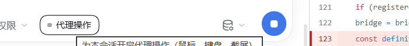
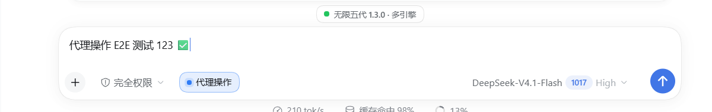
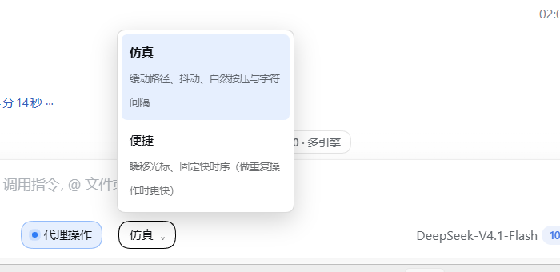
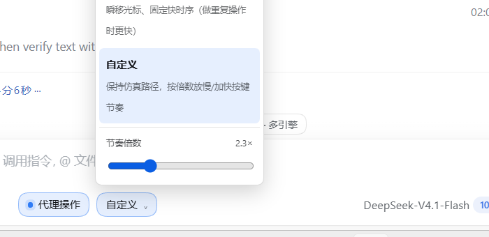

# dsh-gui-agent

**鼠标键盘代理操作 · 真人模拟（Mouse & keyboard agent control with human-like pacing）**

给 DeepSeek Harness 的输入框加一个**会话级**开关「代理操作」。开启后，代理获得真实的
Windows 级鼠标、键盘、窗口与截屏能力，可以像人一样操作浏览器、聊天框和任何桌面程序：
点击按钮、在输入框里打字、切换窗口、等页面加载，然后用截屏确认结果。

A session-scoped switch in the DSH composer. Turn it on and the agent gets real Windows
mouse, keyboard, window and screenshot control — click buttons, type into inputs, switch
windows, wait for a page, then verify with a screenshot.





## 能力 / What it does

| 工具 / Tool | 作用 / Purpose |
| --- | --- |
| `computer_screenshot` | 截取桌面或单个显示器，PNG 直接作为图片内容块返回给模型 |
| `computer_mouse` | 移动、点击、双击、右键、滚轮、拖拽；命中危险控件时先拒绝 |
| `computer_keyboard` | 文本输入（ASCII 走 VK 击键，中文回落到 Unicode）、组合键 |
| `computer_window` | 枚举窗口、激活、最小化/最大化/还原/关闭 |
| `computer_wait` | 等待动画或页面加载 |
| `computer_uia` | 用 UI Automation 在窗口里按名称/类型查找控件，或读取某坐标处的控件 |
| `computer_account` | 窗口标题子串 ↔ 账号标签的映射，切换并校验前台窗口 |
| `computer_queue` | 批量 prompt 队列：add / next / complete / fail / list / clear |
| `computer_downloads` | 列下载目录、等待新下载、把新文件收集到 `~/Pictures/dsh-gui-agent/<账号>` |

九个工具全部只在开关开启时注册；关闭时它们不存在于模型侧工具栏，也没有提示段。

## 真人模拟 / Human-like input pacing

这是本插件与常见 computer-use 插件的差异所在：输入不是「瞬移+瞬时按键」，而是默认走拟真路径。

- **原生输入**：所有点击与按键都走 Win32 `SendInput`（`SetCursorPos` 定位 + `INPUT` 事件），
  与真实鼠标键盘同一条系统路径，页面拿到的是 `isTrusted` 事件。不使用 CDP、WebDriver、
  浏览器扩展注入或 DOM 合成事件。
- **轨迹**：光标沿两段非对称三次贝塞尔移动（弧线偏移随机、末端 2–8px 过冲再 2–4 步回拉），
  单步 ±1px 抖动，耗时按距离在 120–540ms 之间随机。
- **按键**：ASCII 走 `VkKeyScanW` 的真实 VK 事件（含 Shift 组合，页面读到正常的 `key`
  值，而不是 `Unidentified`）；非 ASCII 才回落到 `KEYEVENTF_UNICODE`。
  字符间隔是对数正态分布，空格 ×0.7、标点 ×1.18，约每 11 个字符一次长停顿；
  字母与数字有 3% 概率先打错一个键再用退格重打。
- **点击**：按下前有 150–500ms 犹豫，按下 45–95ms，连击间隔 70–140ms。
- **节奏档**：开关开启后，输入框左侧出现「仿真 / 便捷 / 自定义」下拉。
  `仿真`（默认）走上述轨迹与时序；`便捷` 瞬移光标、固定快时序（重复劳动更快）；
  `自定义` 保留仿真路径，用 0.2–8× 滑杆整体放慢或加快。
  单次工具调用还可以用 `instant: true`、`pace: "fast"`、`slowdown: 2.5` 覆盖。





## 安全模型 / Safety model

- **默认关闭，按会话生效**。开启状态写入 `%LOCALAPPDATA%\dsh-gui-agent\state.json`，
  宿主重启后按 12 小时 TTL 恢复，超时自动失效。
- **只有用户能开启**。开关是输入框左侧的按钮，工具无法自行打开该状态。
- **关闭即消失**。关闭时 `computer_*` 不会注册到模型；开关状态由插件自有路由维护，
  路由用 `connection.requestRejection` 做与 DSH API 相同的 Host/Origin 与浏览器认证。
- **危险控件拦截**。点击前用 UI Automation 反查落点上的控件名，命中
  `发送 / 提交 / 购买 / 支付 / 下单 / 删除 / 发布 / 分享 / 注销 / 退出登录`（含英文同义词）
  时直接拒绝，必须由用户明确同意后代理才能带 `confirm: true` 重试。
- **截图会外发**。截图把屏幕可见内容发给模型，开启前请确认屏幕内容可以外发。

## 安装 / Install

在 DSH 里通过插件管理器安装：

```
plugin_manager action=install_bundle target=<本仓库目录或包名>
```

或在 `dsh plugin` CLI 里：

```sh
dsh plugin --profile <profile> add github:ChinXavier/dsh-gui-agent
```

安装后刷新 Web 页面，输入框工具行左侧出现「代理操作」开关。开关**关闭时只有这一个按钮**；
开启后才在它右边出现节奏下拉（同一格内，不额外占位）。

## 结构 / Layout

```
index.js              Host 入口：会话状态、路由、惰性注册工具与提示段、状态恢复
lib/store.js          持久化（会话开关、节奏、账号映射、队列、下载基线），原子写
lib/win-bridge.js     PowerShell 常驻进程的 JSON-lines 桥
lib/keys.js           按键名 -> Windows VK 码
lib/tools.js          9 个 computer_* 工具定义
client.js             conversation.input.left 的开关 + 节奏下拉
helper/computer.ps1   SendInput / GDI 截屏 / 窗口枚举 / UI Automation（DPI 感知）
test/                 Host 契约与工具行为回归（node --test 直接跑）
```

## 实现要点 / Notes

- **状态**：`lib/store.js` 持有 `{ sessions, paces, slowdowns, accounts, downloads, queue }`，
  写盘去抖 250ms、临时文件 + rename 原子替换；启动时加载并清理过期会话。
- **惰性注册**：仅当至少一个会话开启时才向 `tools` 注册 9 个工具并注入提示段；
  全部关闭时反向注销。插件在 `ctx.inject(['webServer'])` 内注册路由，避免宿主重启时
  服务尚未就绪导致路由缺失。
- **执行层**：一个常驻 `powershell.exe -File helper/computer.ps1`，JSON-lines 请求/响应。
  `SendInput` 使用 `LayoutKind.Explicit, Size = 40` 的 `INPUT` 结构并检查返回值；
  `SetProcessDpiAwarenessContext(PER_MONITOR_AWARE_V2)` 保证坐标系与屏幕像素一致。
- **UIA**：`ControlViewWalker` 深度优先遍历（节点数/深度/时间上限），返回名称、控件类型、
  矩形与中心点；`AutomationElement.FromPoint` 用于点击前的控件识别。
- **截图**：GDI 截屏写入临时 PNG → `attachments.saveImage` → 以
  `{ type: 'image', attachment: { attachmentId, mediaType, bytes, width, height } }`
  内容块返回。文本块附带屏幕/图像尺寸、缩放、光标位置与前台窗口标题。

## 已知限制 / Limits

- 仅 Windows（PowerShell 5.1，无第三方依赖、无 Python、无驱动、无 MCP 进程）。
- UAC 提权窗口（更高完整性级别）收不到注入输入。
- DRM / 受保护画面可能截到黑屏。
- 每进程只允许挂一个 `computerUse` 提供者；本插件直接驱动输入，不占用该服务名额。
- UIA 对 Electron/Chromium 窗口的 Web 内容依赖首次 attach 后可达；部分自绘控件没有可访问性名称。
- 下载收集按文件名做基线比对，同名覆盖由浏览器决定，插件只按冲突改名保存。

## 关键词 / Keywords

鼠标键盘代理操作 · 真人模拟 · 电脑操作 · 桌面自动化 · 浏览器操作 · 截屏视觉 ·
UI Automation · 多账号批量 · Windows computer use · desktop automation ·
mouse and keyboard agent · human-like input · screenshot vision · session-scoped toggle

## 许可 / License

MIT
